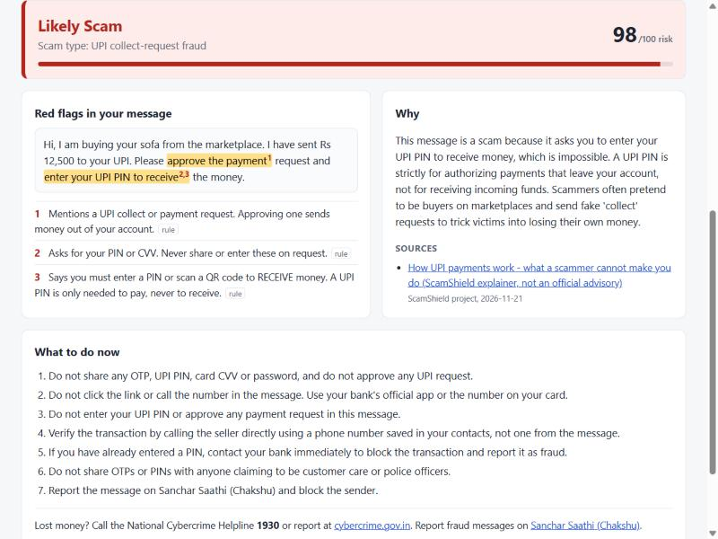
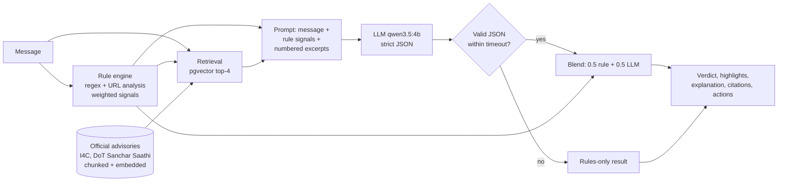

# ScamShield India: "Is this a scam?"

Paste a suspicious SMS, WhatsApp message, email, UPI payment request or link. ScamShield returns:

* a verdict (Safe / Suspicious / Likely Scam) with a 0-100 risk score and the scam type
* the red flags highlighted inside your own message
* a plain-English explanation with citations to official Indian advisories
* what to do now: never share OTP/UPI PIN, report on Sanchar Saathi (Chakshu), call the National Cybercrime
  Helpline **1930** or report at **cybercrime.gov.in** if money was lost

Built for Arthaton 2026 (AI for finance: scam and fraud detection).

**Demo video (2:57):** https://youtu.be/vLxL7RPN0Yk



## How it works



1. **Rule engine** (`rules/RuleEngine.java`): about 20 weighted, explainable signals. These cover OTP or PIN
   requests, "enter PIN to receive money", UPI collect requests, urgency, account/KYC/SIM blocking threats, prizes,
   task-based jobs, guaranteed returns, instant loans with fees, electricity disconnection, seized parcels, police or
   "digital arrest" threats, remote-access apps and personal phone numbers. Links are analysed for shorteners, raw IP
   hosts, punycode, risky TLDs, bank lookalike domains and plain HTTP. A genuine "do not share your OTP" notice lowers
   the score, unless the same message also asks for the OTP. Every signal keeps its character span for highlighting.
2. **RAG** (`rag/AdvisoryStore.java`): advisories in `data/advisories/*.md` (summaries in our own words, with source
   URL and date) are chunked by paragraph, embedded with `nomic-embed-text` and stored in PostgreSQL + pgvector
   through Spring AI. The top-4 chunks are retrieved for each message.
3. **LLM** (`llm/LlmAnalyzer.java`): the message, the rule signals and the numbered excerpts go to the model, which
   must return strict JSON (`verdict, risk_score, scam_type, red_flags[{text_span, reason}], explanation, citations,
   actions`). Every field is validated. Red-flag spans must occur in the message, and citations are excerpt
   numbers that the server maps to the real title and URL, so the model cannot invent a link. On timeout, invalid
   JSON or an unreachable model, the API returns the rules-only result.
4. **Blend:** final risk = 0.5 x rule score + 0.5 x LLM score. Below 30 is Safe, 30-59 Suspicious, 60+ Likely
   Scam. The UI's "Why this verdict" panel shows both scores and every rule signal with its points.

## AI models and APIs used

| Purpose | Model / API | Where it runs |
|---|---|---|
| Classification + explanation | `qwen3.5:4b` (Qwen 3.5, 4B) via Ollama, temperature 0, JSON mode, thinking off | locally (Ollama) |
| Embeddings for RAG | `nomic-embed-text` via Ollama (768-d) | locally (Ollama) |
| LLM / vector-store integration | Spring AI 2.0.1 (`ChatClient`, `OllamaChatModel`, `PgVectorStore`) | in the app |

No external AI API or API key is needed; the model can be changed with `CHAT_MODEL`.

## Evaluation

`data/eval/samples.csv` has 60 **synthetic** labelled messages (36 scams across 10 types, 24 genuine messages
including bank OTPs, debit/credit alerts, delivery and bill reminders). All names, numbers and domains are invented.
`scripts/eval.py` runs them through the live API and reports hybrid, rules-only and LLM-only results from the same
responses.

Run of 21 Nov 2026, flagged = score of 30 or more (full output in [docs/eval-results.md](docs/eval-results.md),
per-message predictions in `docs/eval-predictions.csv`):

| System | Accuracy | Precision | Recall | F1 |
|---|---|---|---|---|
| Hybrid (rules + RAG + LLM) | 1.000 | 1.000 | 1.000 | 1.000 |
| Rules only | 0.967 | 1.000 | 0.944 | 0.971 |
| LLM only (`qwen3.5:4b`) | 1.000 | 1.000 | 1.000 | 1.000 |

* Scam-type accuracy (hybrid, 36 scam messages): 34/36 = 0.944.
* Hybrid three-way verdicts: all 24 genuine messages Safe; of 36 scams, 31 Likely Scam and 5 Suspicious.
* LLM answered for 60/60 messages; median latency 6.5 s per message on an RTX 3050 laptop GPU.

**Read these numbers with care.** The set is small, synthetic, and was written by the same author as the rules, so
it is easier than real traffic. It shows that the pipeline works end to end and doesn't flag the genuine look-alikes
we included (bank OTPs, debit alerts, bill reminders). It is not an estimate of real-world accuracy.

## Run it

Prerequisites: Docker, Java 21+, [Ollama](https://ollama.com) with the two models:

```bash
ollama pull qwen3.5:4b
ollama pull nomic-embed-text
docker compose up -d db          # PostgreSQL 17 + pgvector on port 5433
./mvnw spring-boot:run           # http://localhost:8080
```

Or everything in containers (Ollama still on the host): `docker compose --profile full up --build`.

* Web UI: http://localhost:8080
* API docs (Swagger UI): http://localhost:8080/swagger-ui.html
* Health: `GET /actuator/health`

```bash
curl -s localhost:8080/api/v1/analyze -H "Content-Type: application/json" \
  -d '{"text":"Your SBI account will be blocked today. Update KYC at http://sbi-kyc.xyz","channel":"sms"}'
```

| Endpoint | Description |
|---|---|
| `POST /api/v1/analyze` | `{text, channel?}` -> verdict, risk score, scam type, red flags with spans, explanation, citations, actions, rule signals |
| `GET /api/v1/examples` | the synthetic demo examples |
| `GET /actuator/health` | health |

`/analyze` is rate limited per IP (20/min, `RATE_LIMIT_PER_MINUTE`). Settings are environment variables; see
`.env.example`. Tests: `./mvnw test` covers rule-engine unit tests, LLM-output validation, and a web-layer test of
`/analyze` with a mocked LLM.

## Data sources

| Source | URL | Used for |
|---|---|---|
| I4C advisory on "Digital Arrest" scams (TAU/ADV/003, 6 Mar 2025) | https://i4c.mha.gov.in/theme/resources/advisories/ADVISORYTAU-ADV-003DigitalArrest06.03.2025.pdf | RAG |
| I4C home page (1930 helpline, cybercrime.gov.in, safety tips) | https://i4c.mha.gov.in/ | RAG, action list |
| Sanchar Saathi Chakshu (DoT) | https://sancharsaathi.gov.in/sfc/ | RAG, action list |
| Embassy of India advisory on fake overseas job rackets (listed by I4C, 31 May 2024) | https://i4c.mha.gov.in/theme/resources/advisories/Advisory_on_Job_Scam_dated_31_May_2024-amended.pdf | RAG |
| ScamShield explainer of UPI behaviour (ours, labelled as not official) | `data/advisories/scamshield-upi-basics.md` | RAG |

The advisory files contain short summaries in our own words with a link to the original, not copies of the
documents. The RBI BE(A)WARE booklet and NPCI safety pages could not be retrieved reliably at build time (CAPTCHA
or script-only pages), so they are not in the corpus. No real personal data, bank details or keys are in this repo.

## Limitations

* A 4B local model is fast enough on a laptop GPU (about 5-20 s per message) but makes mistakes; the rule engine
  and the blend keep the score stable when it does.
* Regex rules are English-centric; Hinglish/Hindi messages get weaker rule coverage (the LLM still sees them).
* The evaluation set is small and synthetic; real-world accuracy will differ.
* This is an awareness tool, not a guarantee; always verify through official channels.

## Credits

Spring Boot, Spring AI, PostgreSQL + pgvector, Ollama, Qwen 3.5 (Alibaba Qwen team), nomic-embed-text (Nomic AI),
springdoc-openapi. Official advisory content belongs to the respective government bodies and is linked, not copied.
